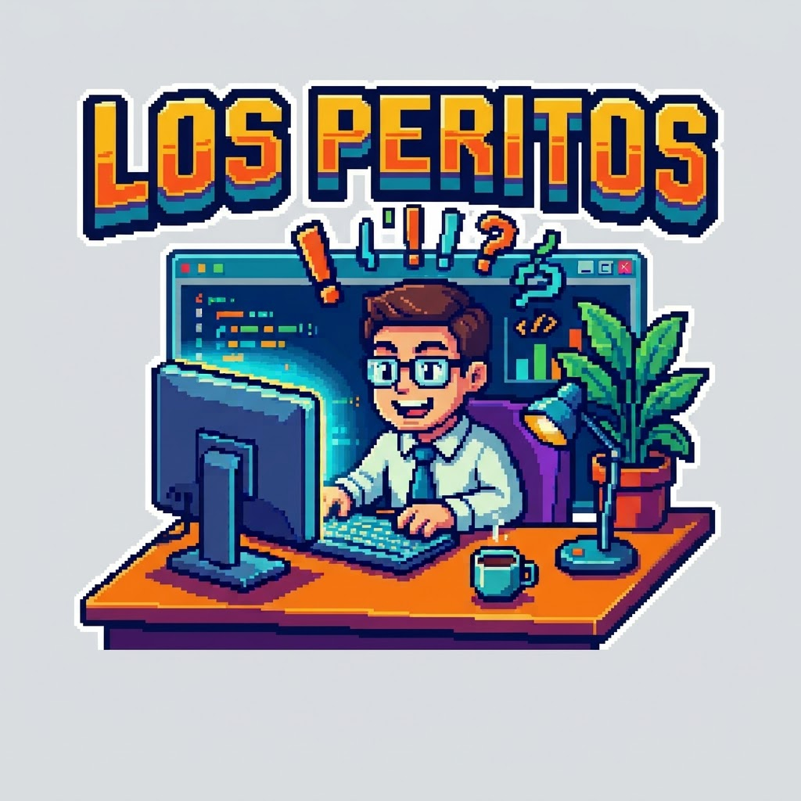
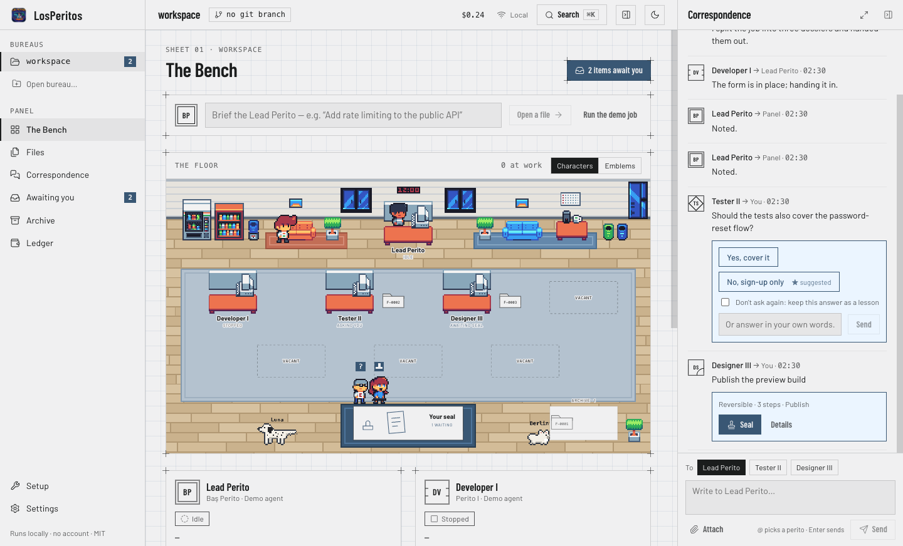
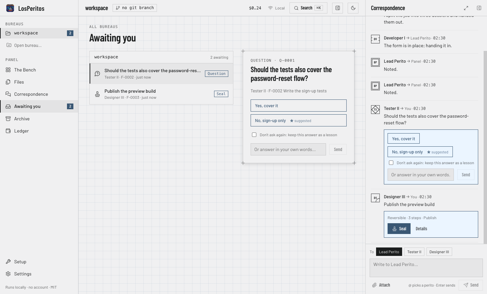
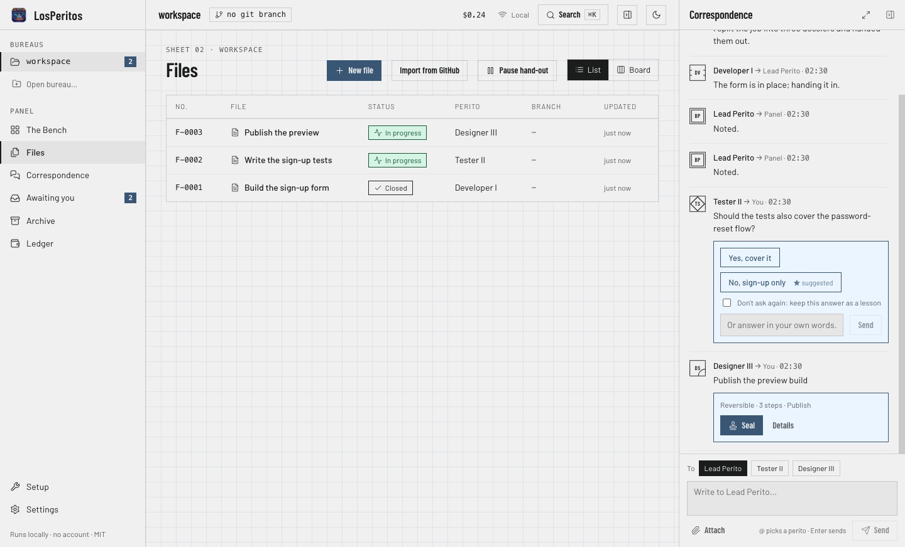
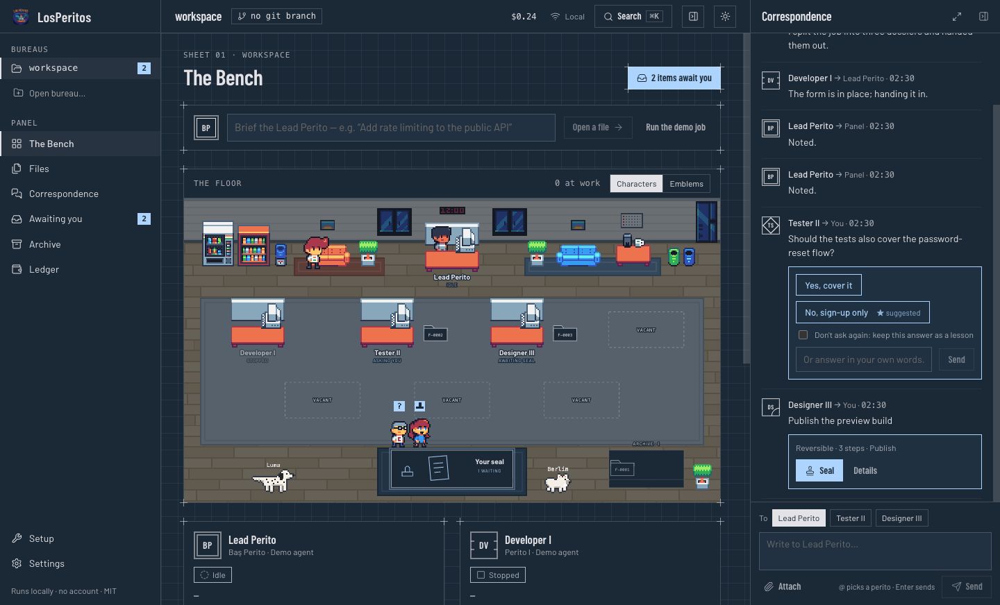

<p align="center"></p>

# LosPeritos

A desktop app that runs a small team of AI coding agents on your own machine,
and keeps you in charge of it. *Los peritos* is Spanish for "the experts".

You open a project folder and tell the lead what you want. The lead splits the
job, hands the parts to up to seven team members, and each one works on its own
git branch. Nothing is merged, and nothing risky is run, until you put your
seal on it.



- **Your own account.** Agents run on your Claude Code CLI. LosPeritos sells no
  AI usage and sits between you and nobody.
- **Local.** No sign-in, no telemetry. Project data lives in
  `<your folder>/.losperitos/`.
- **Free and open.** MIT licensed.

> **Status: early (0.1).** It works end to end on macOS with Claude Code.
> Expect rough edges, and read [what is not there yet](#what-is-not-there-yet).

## What you get

| | |
|---|---|
|  |  |
| **Awaiting you** gathers every question and seal request, across all your projects. | **Files** lists the work: who has it, on which branch, in what state. |

- **The Bench.** A live view of the bureau: who is working, who is waiting on
  you, where each piece of work is. A perito with a question walks to your desk.
- **Correspondence.** A chat panel that stays open on every screen. Write to
  the lead, or to one perito with `@`; answer questions and seal requests in
  place; attach files.
- **Seals.** Merges always wait for you. So do commands that publish, deploy,
  delete or reach other machines, enforced by a permission bridge the agent
  cannot skip.
- **Reports.** Every finished file comes with three lists: done, tested, and
  *not verified*.
- **Lessons.** Peritos propose standing rules; the ones you accept are given to
  every perito from then on. "Don't ask again" on an answer does the same.
- **A daily budget** per project, with a warning at 80% and no new work once
  it is spent.
- **Staying on the job.** Conversations survive a restart; a perito that hits
  your usage limit waits and carries on by itself when it resets.
- **English and Turkish**, light and dark.



## Requirements

- macOS on Apple silicon (the only platform tested so far).
- [git](https://git-scm.com/downloads).
- [Claude Code](https://claude.com/claude-code), signed in. LosPeritos uses
  your existing login.
- [Node.js](https://nodejs.org) 22 or newer, to build from source.
- Optional: the [GitHub CLI](https://cli.github.com) to import issues.

## Try it

There are no downloadable releases yet, so build it:

```bash
git clone <this repository>
cd LosPeritos
npm install
npx install-electron
npm run desktop:demo
```

`desktop:demo` runs scripted agents that spend nothing: press **Run the demo
job** and watch. When you are ready for the real thing:

```bash
npm run desktop
```

Open **Setup**, choose a project folder, and brief the lead.

To build a standalone app (and a `.dmg` on macOS):

```bash
npm run package
```

See [Building and signing](CONTRIBUTING.md#building-and-signing).

## How a job flows

1. You brief the lead. Small jobs it does itself; larger ones it splits into
   files.
2. Each file goes to a perito, who works in its own git worktree under
   `.losperitos/worktrees/` on a branch named `peritos/task-<n>-<title>`.
3. The perito commits and hands the file in with a report.
4. That raises a seal request. Sealing merges the branch into the branch you
   had checked out and removes the worktree. If the merge conflicts it is
   aborted, your checkout is left as it was, and the request stays open.

You can also write files yourself, set their priority, make one wait for
another, pause the hand-out, and cancel work under way.

## How much to trust it

Agents run commands on your computer with your permissions. LosPeritos gives
you two modes per project, and you should know exactly what each does:

- **Full** (the default). Peritos edit files and run ordinary shell commands
  without asking. Merges are held for your seal. So are commands that start
  with any of the prefixes in
  [`RISKY_COMMANDS`](packages/adapters/src/claude-code.ts): `git push`,
  `rm -rf`, `sudo`, `npm publish`, `ssh`, common deploy tools, and so on.
- **Restricted.** Peritos can read freely; every edit and every command is
  held for your seal.

Held calls go through the agent CLI's own permission mechanism, so this is
enforced, not merely requested. **It is still a safety net, not a sandbox.**
Commands are matched by how they begin, so an unusual spelling such as
`git -C . push` is not caught, and nothing stops a perito from writing a script
and running it. Use a project you can afford to have changed, keep it under
git, and read [SECURITY.md](SECURITY.md).

## What is not there yet

- Windows and Linux builds, and Intel Macs. Nothing in the design rules them
  out; they have not been built or tried.
- Agent tools other than Claude Code. The adapter interface is there; Codex is
  next.
- Real terminals. Agent output is shown as text lines.
- Several repositories in one folder: branches are only created when the
  folder itself is the repository.
- Automatic updates.
- The usage-limit handling has only been tested against a simulated limit.

The longer list, with what is planned, is in
[docs/yol-haritasi.md](docs/yol-haritasi.md) (Turkish).

## Repository layout

| Path | Purpose |
|---|---|
| `packages/protocol` | API and event types shared by the core and the UI |
| `packages/core` | Local daemon: orchestrator, tasks, approvals, budget, HTTP + WebSocket server |
| `packages/adapters` | Agent CLI adapters: Claude Code, and a scripted fake for tests and the demo |
| `packages/git` | Branches, worktrees, diff and merge |
| `packages/storage` | Reading and writing `.losperitos/` |
| `packages/cli` | `peritos`: how agents talk to the core, and the permission bridge |
| `apps/ui` | React interface |
| `apps/desktop` | Electron shell |
| `docs/` | Design brief, animation notes, roadmap |

## Contributing

Bug reports and pull requests are welcome. Start with
[CONTRIBUTING.md](CONTRIBUTING.md).

## Credits

Office art from the [Pixel Office](https://2dpig.itch.io/pixel-office) pack by
2dPig (CC0). Fonts: Barlow and Barlow Condensed (SIL Open Font License). Icons:
Lucide. Full list in [THIRD_PARTY_NOTICES.md](THIRD_PARTY_NOTICES.md).

Berlin and Luna, the office dogs, are real.

## License

[MIT](LICENSE)
