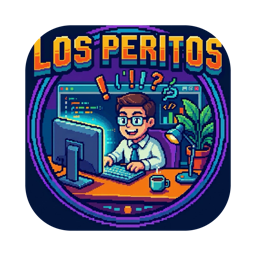
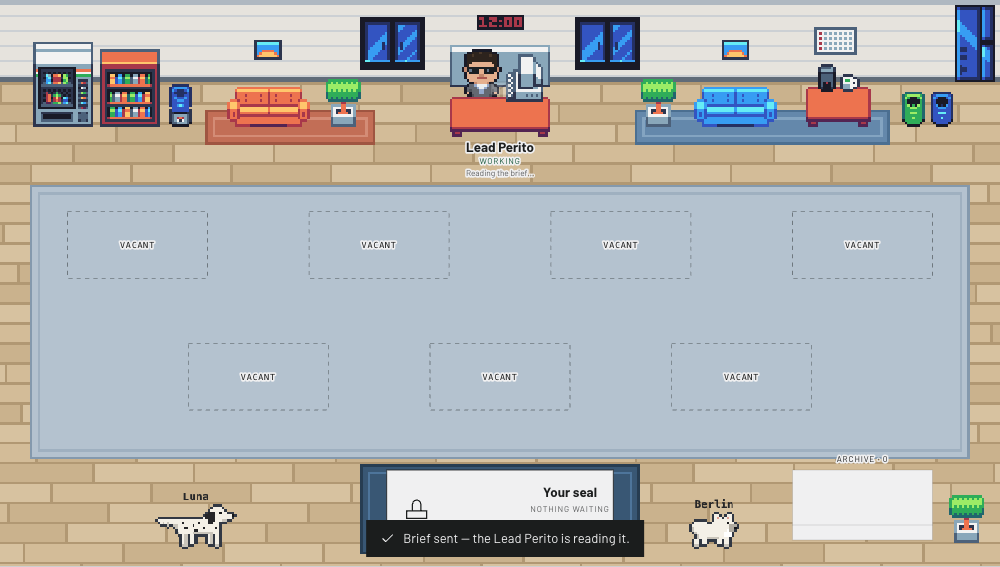
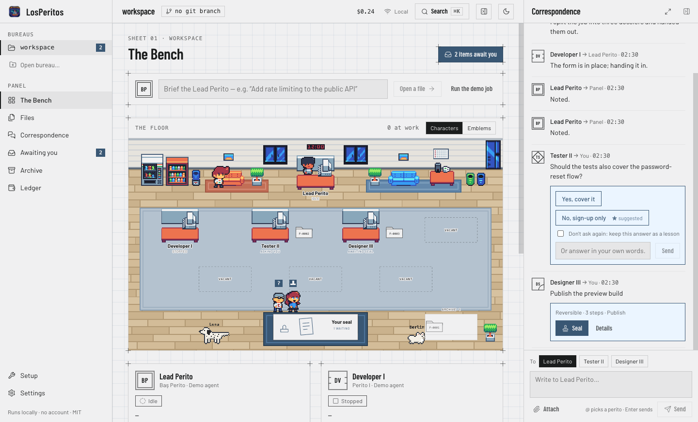
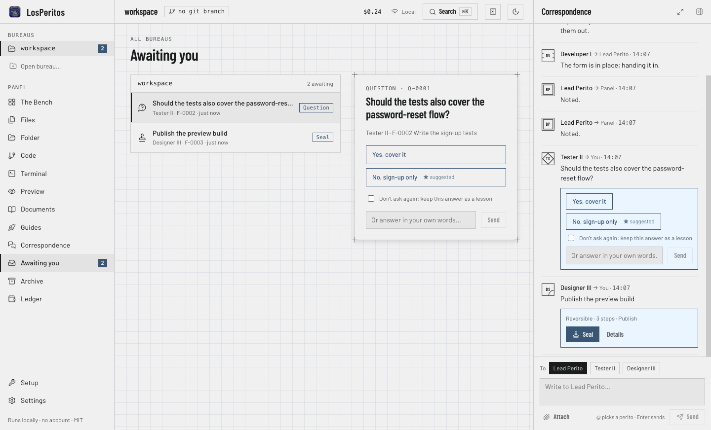
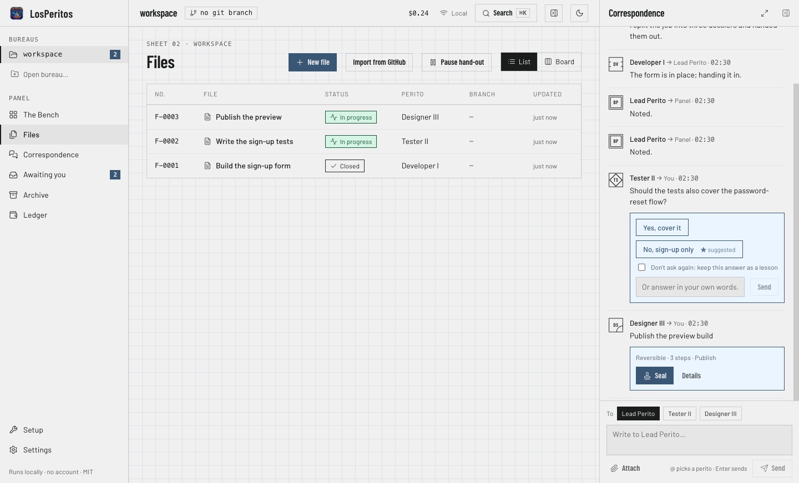
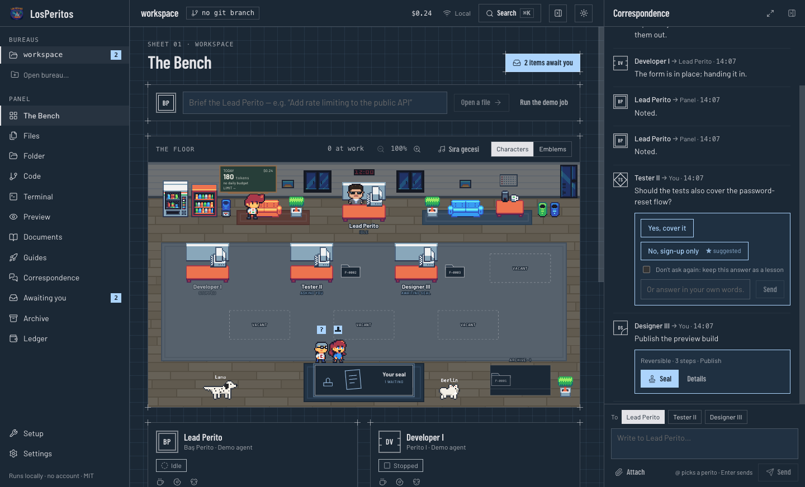

<div align="center">



# LosPeritos

**Kendi yapay zekâ uzmanlar büron.**<br>
Bilgisayarında küçük bir ajan ekibi çalıştıran,<br>
senin mührün olmadan hiçbir şeyi yayına çıkarmayan bir masaüstü uygulaması.

[](https://github.com/peritotr/LosPeritos/actions/workflows/ci.yml)


[Dene](#dene) · [Nasıl çalışır](#bir-iş-nasıl-akar) · [Ne kadar güvenmeli](#ne-kadar-güvenmeli) · [English](README.md)

<br>



<sub>Büro iş başında. Sana ihtiyacı olan perito masana yürür. Berlin ve Luna gözetimde.</sub>

</div>

<br>

*Los peritos* İspanyolcada "uzmanlar" demek. Bir proje klasörü açar ve Baş
Perito'ya ne istediğini söylersin. O işi böler, parçaları en fazla yedi ekip
üyesine dağıtır ve her biri kendi git dalında çalışır. Sen mührünü basana kadar
hiçbir şey birleştirilmez, riskli hiçbir komut çalıştırılmaz.

<table>
<tr>
<td width="33%" valign="top">

### Kendi hesabın

Ajanlar senin Claude Code hesabınla çalışır. LosPeritos yapay zekâ kullanımı
satmaz, seninle sağlayıcın arasına girmez.

</td>
<td width="33%" valign="top">

### Yerel

Kayıt yok, veri toplama yok. Proje verisi `<klasörün>/.losperitos/` içinde durur.
Uygulama günde bir kez GitHub'a yeni sürüm olup olmadığını sorar, varsa indirir ve yeniden başlatınca kurar; Ayarlar'dan kapatılabilir.

</td>
<td width="33%" valign="top">

### Ücretsiz ve açık

MIT lisanslı. Oku, değiştir, kendi sürümünü çıkar.

</td>
</tr>
</table>

> **Durum: erken (0.1).** macOS'ta Claude Code ile uçtan uca çalışıyor.
> Pürüzler olacaktır; [henüz olmayanlar](#henüz-olmayanlar) bölümünü oku.

## Bir göz at



<table>
<tr>
<td width="50%" valign="top">



**Bekleyenler.** Tüm projelerindeki her soru ve her mühür isteği tek yerde.
İlk cevaplanmaya değer soru: *benden ne bekleniyor?*

</td>
<td width="50%" valign="top">



**Dosyalar.** İşin kendisi: kimde, hangi dalda, hangi durumda. Kendin dosya
aç, önceliğini belirle, başka bir dosyayı beklet ya da iptal et.

</td>
</tr>
</table>



Ekran görüntüleri İngilizce arayüzden alındı; arayüzün tamamı Türkçe de var.

## Neler var

| | |
|---|---|
| 🏢 **Heyet Masası** | Canlı büro katı: kim çalışıyor, kim seni bekliyor, hangi iş nerede. |
| 💬 **Yazışmalar** | Her ekranda açık duran sohbet. Baş Perito'ya ya da `@` ile tek bir peritoya yaz. Yerinde cevapla, yerinde mühürle. Dosya ekle. |
| 🔏 **Mühür** | Birleştirmeler her zaman seni bekler. Yayınlayan, deploy eden, silen ya da başka makinelere erişen komutlar da. |
| 📋 **Rapor** | Biten her dosya üç listeyle gelir: yapılanlar, test edilenler ve *doğrulanmayanlar*. |
| 📚 **Dersler** | Peritolar kalıcı kurallar önerir; kabul ettiklerin o andan sonra her peritoya verilir. |
| 💰 **Günlük bütçe** | Proje başına; %80'de uyarı, dolunca yeni iş yok. |
| ⌨️ **Terminal ve önizleme** | Büro klasöründe gerçek kabuklar ve çalışan site; masaüstü, tablet ya da telefon genişliğinde. |
| 📱 **Telefondan** | Aynı ağda: soruları yanıtla, mühürle, Baş Perito'ya yaz. Sen açana kadar kapalı. |
| 🔁 **Takılmayan ekip** | Konuşmalar yeniden başlatmada sürer. Kullanım limitine takılan perito bekler ve kendiliğinden devam eder. |
| 🌍 **İki dil** | Türkçe ve İngilizce, açık ve koyu tema. |

## Gereksinimler

- Apple silicon işlemcili Mac (şimdiye kadar denenen tek platform).
- [git](https://git-scm.com/downloads).
- Giriş yapılmış [Claude Code](https://claude.com/claude-code). LosPeritos
  mevcut oturumunu kullanır.
- Yalnızca kaynak koddan derleyeceksen [Node.js](https://nodejs.org) 22 ya da üstü.
- İsteğe bağlı: issue'ları içe aktarmak için [GitHub CLI](https://cli.github.com).

## Dene

**İndir.** [Son sürümden](https://github.com/peritotr/LosPeritos/releases/latest)
`LosPeritos-0.5.0-arm64.dmg` dosyasını indir, aç ve LosPeritos'u Uygulamalar
klasörüne sürükle. İmzalı ve noter onaylıdır; diğer Mac uygulamaları gibi
açılır. Apple silicon işlemcili Mac ile kurulu
[git](https://git-scm.com/downloads) ve
[Claude Code](https://claude.com/claude-code) gerekir.

**Ya da kaynak koddan derle:**

```bash
git clone https://github.com/peritotr/LosPeritos.git
cd LosPeritos
npm install
npx install-electron
npm run desktop:demo
```

`desktop:demo` hiçbir şey harcamayan senaryolu ajanlarla açılır: **Demo işini
çalıştır** düğmesine bas ve izle. Gerçeği için:

```bash
npm run desktop
```

**Kurulum** ekranını aç, bir proje klasörü seç ve Baş Perito'ya iş ver.

Tek başına çalışan uygulamayı (macOS'ta `.dmg` ile birlikte) üretmek için:

```bash
npm run package
```

## Bir iş nasıl akar

1. **Baş Perito'ya iş verirsin.** Küçük işi kendi yapar, büyüğünü dosyalara böler.
2. **Her dosya bir peritoya gider.** Perito `.losperitos/worktrees/` altında,
   `peritos/task-<n>-<başlık>` adlı kendi dalında çalışır.
3. **Perito dosyayı teslim eder**; yanında rapor: yapılanlar, test edilenler,
   doğrulanmayanlar.
4. **Sen mühürlersin.** Mühür, dalı o an açık olan dalına birleştirir ve
   çalışma kopyasını kaldırır. Birleştirme çakışırsa iptal edilir, depon olduğu
   gibi kalır ve istek açık kalır.

## Ne kadar güvenmeli

Ajanlar bilgisayarında senin yetkilerinle komut çalıştırır. LosPeritos proje
başına iki mod sunar; her birinin tam olarak ne yaptığını bilmelisin:

- **Tam** (varsayılan). Peritolar dosya düzenler ve sıradan kabuk komutlarını
  sormadan çalıştırır. Birleştirmeler mührünü bekler.
  [`RISKY_COMMANDS`](packages/adapters/src/claude-code.ts) listesindeki
  öneklerle başlayan komutlar da bekler: `git push`, `rm -rf`, `sudo`,
  `npm publish`, `ssh`, yaygın deploy araçları ve benzerleri.
- **Kısıtlı.** Peritolar serbestçe okur; her düzenleme ve her komut mührünü bekler.

Bekletilen çağrılar ajan aracının kendi izin mekanizmasından geçer; yani bu bir
rica değil, zorunluluktur. **Yine de bir güvenlik ağıdır, kum havuzu değil.**
Komutlar başlangıçlarına göre eşleştirilir; `git -C . push` gibi alışılmadık bir
yazım yakalanmaz ve bir peritonun betik yazıp çalıştırmasını engelleyen bir şey
yoktur. Değişmesini göze alabileceğin bir projede kullan, projeyi git altında
tut ve [SECURITY.md](SECURITY.md) belgesini oku.

## Henüz olmayanlar

- Windows ve Linux sürümleri, Intel Mac'ler. Tasarımda engel yok; derlenmedi
  ve denenmedi.
- Claude Code dışındaki ajan araçları. Adaptör arayüzü hazır; sırada Codex var.
- Gerçek terminaller. Ajan çıktısı metin satırları olarak gösteriliyor.
- Tek klasörde birden çok depo.
- Otomatik güncelleme.
- Kullanım limiti davranışı yalnızca benzetilmiş bir limitle denendi.

Planlananların uzun listesi: [docs/yol-haritasi.md](docs/yol-haritasi.md).

## Katkı

Hata bildirimleri ve değişiklik önerileri memnuniyetle karşılanır.
[CONTRIBUTING.md](CONTRIBUTING.md) (İngilizce) ile başla.

## Emeği geçenler

Ofis görselleri 2dPig'in [Pixel Office](https://2dpig.itch.io/pixel-office)
paketinden (CC0). Yazı tipleri: Barlow ve Barlow Condensed (SIL Open Font
License). İkonlar: Lucide. Tam liste: [THIRD_PARTY_NOTICES.md](THIRD_PARTY_NOTICES.md).

Ofis köpekleri Berlin ve Luna gerçektir.

## Anısına


**Alpaslan Yılmaz** Ar-Ge Müdürümüzdü, dostumuzdu.<br>
Onu Mart 2025'te kaybettik.<br>
LosPeritos onun anısına adanmıştır.

<br clear="left">

## Lisans

[MIT](LICENSE)
